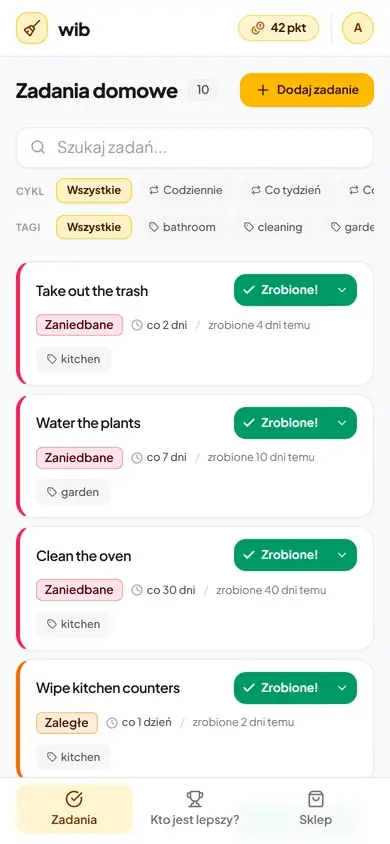
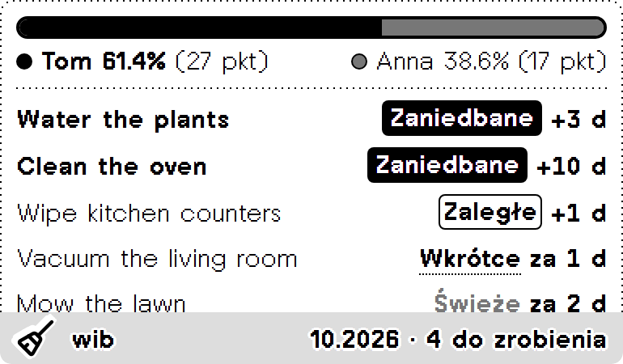
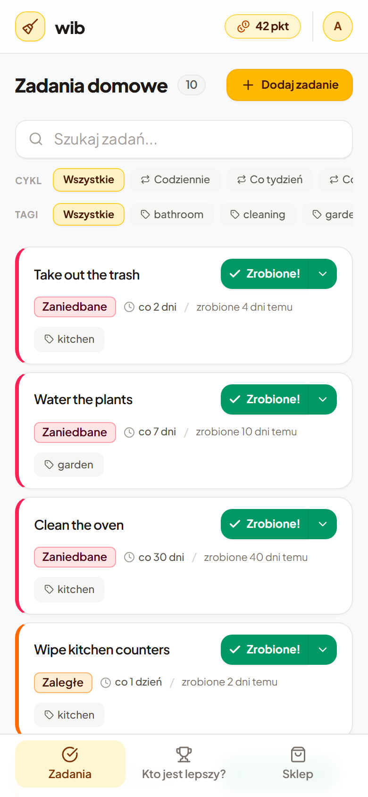
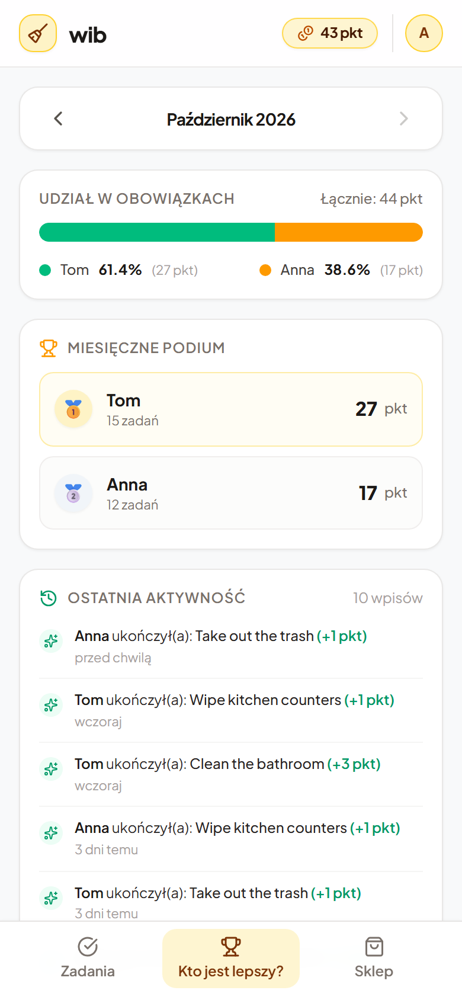
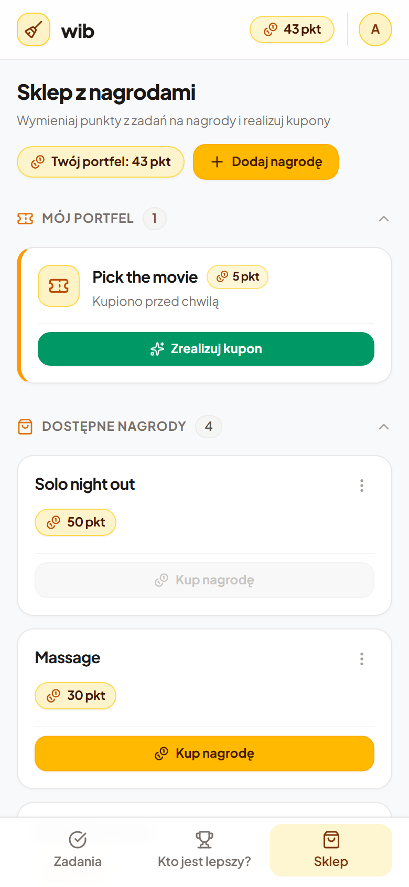

  

<h1 align="center">wib · Who is Better?</h1>

  A household chore tracker that turns chores into a friendly monthly competition with its own reward shop.
   
  Built for one home and used every day from phones.

  
  
  
  

  
   
  The app's interface is in Polish.

---

## How it works

**🧹 Chores without a calendar.** Each chore has a cadence ("every 7 days"), and the clock restarts when someone does it. Nothing piles up after a busy week. Chores are just more or less fresh:

| | Band | Meaning |
|---|---|---|
| 🟢 | Fresh | done recently |
| 🟡 | Due Soon | coming up, or due today |
| 🟠 | Overdue | past its cadence |
| 🔴 | Neglected | well past it; goes to the top |

The backlog puts the most urgent chores first. One tap marks a chore done and awards points.

**🏆 Who is better?** Every month starts a new race. The scoreboard shows each member's share of the month's work as one split bar, along with a podium, all-time stats and a live activity feed.

**🎁 A shop for favors.** Points earned also go into a wallet. Members put up their own rewards (a massage, a solo night out, a new book), buy them as vouchers, and redeem them when the favor is done. Spending never lowers your place in the race.

**📟 On the wall.** A [TRMNL](https://usetrmnl.com) e-ink display at home shows the race and the chores that need attention next.

  

<table>
  <tr>
    <td align="center"> Backlog, most urgent first</td>
    <td align="center"> Monthly race</td>
    <td align="center"> Reward shop and wallet</td>
  </tr>
</table>

## Under the hood

| | |
|---|---|
| Backend | ASP.NET Core (.NET 10) minimal API, EF Core on MariaDB, with the domain in a dependency-free `Wib.Domain` library |
| Frontend | React 19 + TypeScript + Vite, Tailwind CSS, TanStack Query; installable as a PWA |
| Auth | Auth0, members created on first login |
| Tests | xUnit domain and endpoint tests, Playwright end-to-end journeys |
| Hosting | One Docker image on a small VPS, built and published by GitHub Actions |

## Find your way around

- **[CONTEXT.md](CONTEXT.md)**: the domain language, with the exact rules for Freshness, Completion Outcomes, the Monthly Race and the shop.
- **[docs/adr/](docs/adr/)**: architecture decisions and why they were made.
- **[AGENTS.md](AGENTS.md)**: how to run and test the project locally, written for both humans and coding agents.
- **[trmnl/](trmnl/)**: the TRMNL Display plugin and its setup.
